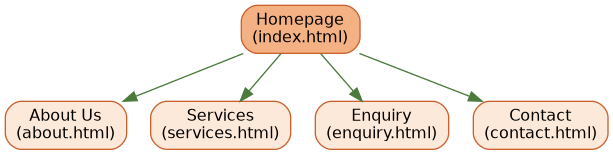
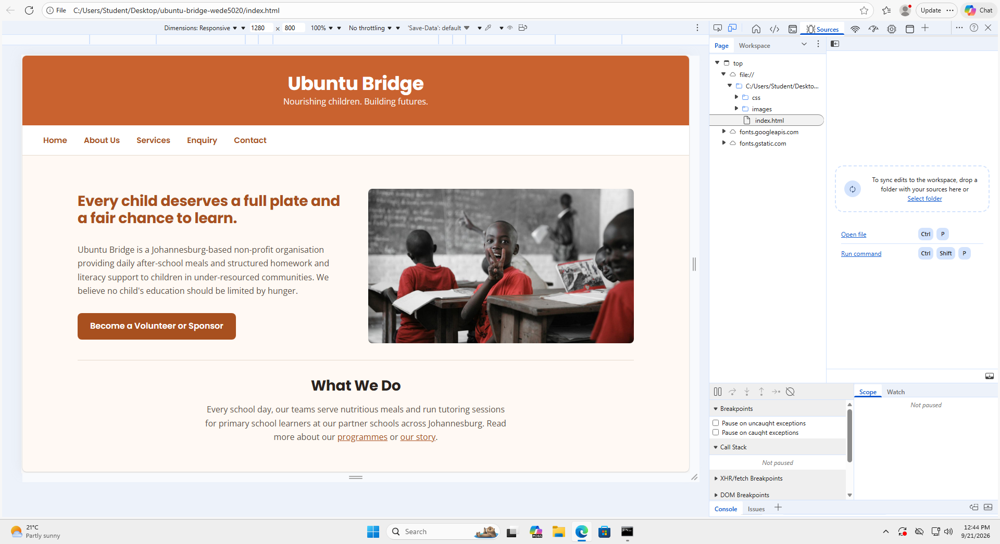
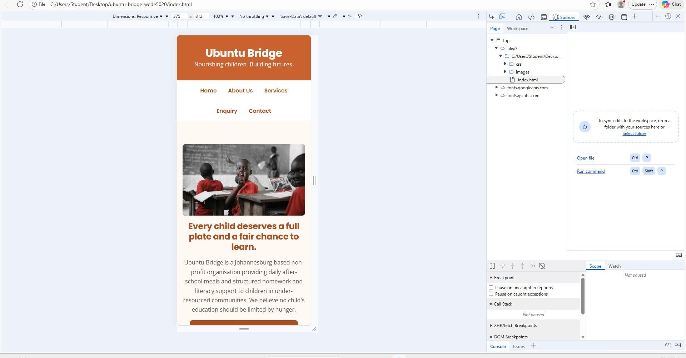

# Ubuntu Bridge Website - WEDE5020 POE

## Student Information
- Student Name: Zwakele Panza
- Student Number: ST10539588
- Institution: The IIE Rosebank College
- Module: WEDE5020 - Web Design and Development

## Project Overview
A website for Ubuntu Bridge, a Johannesburg-based non-profit organisation
providing after-school meals and homework/literacy support to children in
under-resourced communities. This project is built across three parts:
foundational HTML structure (Part 1), CSS styling and responsive design
(Part 2), and JavaScript functionality, forms, and SEO (Part 3).

## Website Goals and Objectives
- Increase awareness of Ubuntu Bridge's programmes among potential donors and volunteers.
- Provide a simple, trustworthy channel for online enquiries about volunteering and sponsorship.

## Key Features and Functionality
- Homepage introducing the organisation and its mission
- About Us page with history, mission, and vision
- Services page detailing the meal and tutoring programmes
- Enquiry page for prospective volunteers/sponsors
- Contact page with multiple locations and a general enquiry form

## Timeline and Milestones
- Part 1: Planning, proposal, sitemap, and HTML structure
- Part 2: CSS styling and responsive design
- Part 3: JavaScript functionality, forms, SEO, and deployment

## Part 1 Details
See `sitemap.png` for the site's page hierarchy. Folder structure:

```
ubuntu-bridge/
├── index.html
├── about.html
├── services.html
├── enquiry.html
├── contact.html
├── sitemap.png
├── css/
│   └── style.css
├── js/
└── images/
```

## Sitemap


## Part 2 Details
`css/style.css` was fully built out for Part 2, styled mobile-first with
progressive enhancement via `min-width` media queries at 600px (tablet) and
900px (desktop):

- **Colour scheme**: terracotta orange (`#a8501f` / `#c9622f`) and leaf
  green (`#3f6b43`), matching the Part 1 proposal, defined as CSS custom
  properties in `:root` so the palette only needs to change in one place.
- **Typography**: Google Fonts `Poppins` (headings) and `Open Sans` (body),
  linked in each page's `<head>`, with a simple type scale for `h1`–`h3`.
- **Layout**: CSS Grid used for two-column desktop layouts (hero image/text,
  About Us mission/vision and team, Services meal programme, Contact
  locations), collapsing to a single column below the desktop breakpoint -
  no extra wrapper `<div>`s were added; grid placement targets the existing
  `id`/`nth-of-type` selectors directly to keep selector count low.
- **Visual styling**: card-style backgrounds and shadows for the Services
  sections and forms, `:hover`/`:focus`/`:active` states on nav links and
  buttons, styled form inputs with focus outlines.
- **Responsive images**: images are set to `max-width: 100%` so they scale
  fluidly within their containers at every breakpoint.
- **Screenshot evidence**: screenshots of 'index.html' at desktop, tablet, and mobile widths are included in the 'screenshots/' folder:

**Desktop (1280px)**


**Tablet (768px)**
**

 
## Changelog
- **2026-08-14**: Initial commit - created HTML structure for 5 pages
  (index, about, services, enquiry, contact), base stylesheet, folder
  structure, and sitemap for Part 1.
- **2026-09-17**: Part 2 - built out `css/style.css` in full: CSS custom
  properties for the terracotta/leaf-green colour scheme, Google Fonts
  typography (Poppins/Open Sans), base styles and reset, header/nav/footer
  styling with interactive states, CSS Grid layouts for hero/team/mission-
  vision/meals/locations sections, styled forms (enquiry and contact), and
  mobile-first responsive breakpoints at 600px and 900px. Added Google
  Fonts `<link>` tags to the `<head>` of all five HTML pages.

## References
- Mozilla Developer Network (2026) *HTML: HyperText Markup Language*. Available at: https://developer.mozilla.org/en-US/docs/Web/HTML (Accessed: 14 August 2026).
- World Wide Web Consortium (2026) *Web Content Accessibility Guidelines (WCAG) 2.1*. Available at: https://www.w3.org/WAI/WCAG21/quickref/ (Accessed: 14 August 2026).
- Google (2026) *SEO Starter Guide*. Available at: https://developers.google.com/search/docs/fundamentals/seo-starter-guide (Accessed: 14 August 2026).

## Live Site

Deployed on Netlify: https://endearing-sundae-6a01a0.netlify.app

## Changelog

### Part 3 – Functionality & SEO
- Added detailed code comments across all HTML, CSS, and JS files
- Implemented client-side form validation with simulated AJAX submission on the Enquiry and Contact forms (js/enquiry.js, js/contact.js)
- Added an accessible FAQ accordion to the Services page (js/accordion.js)
- Replaced static map placeholders on the Contact page with embedded Google Maps iframes for both site locations
- Added SEO meta descriptions to all 5 pages
- Added robots.txt and sitemap.xml for search engine indexing
- Deployed the site live to Netlify and updated sitemap.xml/robots.txt with the live deployment URL
